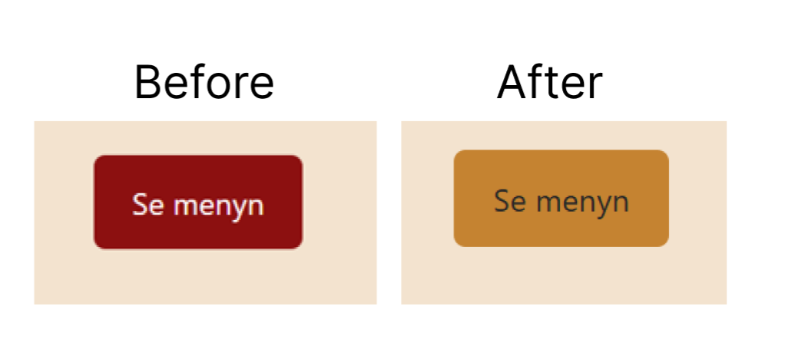

# Dag 10 · GitHub och publicering

_Modul 4, UI/UX & Frontendutveckling, Lexicon IT-Proffs_

## Vad du ska göra idag

Du skickar upp ditt arbete med `git push` och publicerar sidan på riktigt med GitHub Pages. Du får en publik adress som alla kan öppna.

## Bakgrund

Hittills har dina commits bara funnits på din dator. Ett _remote_ repo på GitHub är både en säkerhetskopia och ett sätt att dela. **GitHub Pages** gör att GitHub visar dina HTML-filer som en riktig webbplats på `https://ditt-namn.github.io/repo/`.

## Så arbetar du (samma som alltid)

1. **Forka** dagens repo på GitHub (_Fork → Create fork_).
2. **Klona din fork:** _Code → HTTPS → kopiera adressen_. I terminalen (Ctrl+ö i VS Code): `git clone <adressen>`. Öppna den nya mappen i VS Code och starta _Live Server_.
3. **Gör uppgiften.** Spara och kontrollera i webbläsaren efter varje steg. Gör en commit efter varje avslutat steg: `git add .` och `git commit -m "Beskriv vad du gjorde"`.
4. **Skicka upp** när du är klar: `git push`.
5. **Lämna in i Microsoft Forms.**

Fastnar du: skriv ner exakt var och vad du försökt, och ta det först i nästa handledda pass.

## Uppgiften steg för steg

### Steg 1. Kontrollera kopplingen

I terminalen: `git remote -v`. Du ska se `origin` med adressen till din fork på GitHub. Det kommer från att du klonade den.

### Steg 2. Kontrollera historiken på GitHub

Öppna din fork på GitHub och klicka _Commits_. Dina commits sedan dag 1 ska synas. Det är samma `git push` som du kört hela tiden. Första gången kan GitHub ha bett dig logga in, och det behövs normalt inte igen.

### Steg 3. Gör en commit och push i ett svep

Ändra något litet, kör `git add .`, `git commit -m "..."` och `git push`. Verifiera på GitHub. Du har nu den vanliga arbetsloopen: ändra, add, commit, push.

### Steg 4. Slå på GitHub Pages

På GitHub, i din fork: _Settings → Pages_. Under _Build and deployment_: Source = _Deploy from a branch_, Branch = `main`, mapp `/ (root)`. Spara. Vänta 1–2 minuter.

### Steg 5. Öppna din sida

Överst på Pages-inställningen visas adressen. Öppna den. Fungerar bilderna och CSS:en? Annars: kontrollera att sökvägarna är relativa (`css/base.css`, inte `/css/base.css`).

### Steg 6. Skriv README

Redigera `README.md`: rubrik, en mening om vad sajten är, länk till live-sidan, och vilka tekniker du använt. Commit, push.

## Kontrollista: så vet du att du är klar

- [ ] `git push` har skickat upp alla dina commits.
- [ ] Din fork har GitHub Pages påslaget, och live-länken fungerar.
- [ ] Bilder och CSS laddas på den publicerade sidan.
- [ ] README.md beskriver projektet och innehåller live-länken.
- [ ] Du har skickat in länken till din fork och din live-länk.

## Tips om du fastnar

- 404 på sidan? Vänta några minuter och kontrollera att filen heter exakt `index.html` i rotmappen.
- Bilderna saknas? Sökvägar får inte börja med `/` och filnamn är känsliga för versaler.
- Repot måste vara publikt för att Pages ska fungera på ett gratiskonto.
- Push avvisas? Kör `git pull` först och försök igen.

## Inlämning

**Deadline: imorgon klockan 09.00.** Allt lämnas in i Microsoft Forms. Du behöver inte redovisa något muntligt.

I formuläret fyller du i:

1. Länk till din fork av det här repot.
2. Reflektion: Klistra in live-länken. Vad var det första du tänkte när du öppnade din publicerade sida?

## Vill du mer? (frivilligt)

- Lägg till en `.gitignore`.
- Lägg till en skärmbild av sidan i README.md.

---

---

---

# Updates on README.md file

_Link to published page_ [Kafé Kardemumma](https://marihan89.github.io/marihan-m4-dag10-github-och-publicering/)

## commands used throught the process

1- First we needed to stage the changes

    git add css/variables.css
    git add css/Components.css

2-commit them

    git commit -m "my msg"

3- pushed the changes

    git push

4-decided to change the commit msg using ammend

    git commit --amend -m  "changed button bg color and  text color with contrast 4.8:1"

5-Force pushing

    git push --force-with-lease

## Changes made

---

# **My CheckList**

-[x] 

-[x] 

-[x] 

-[x] 

-[ ] 
